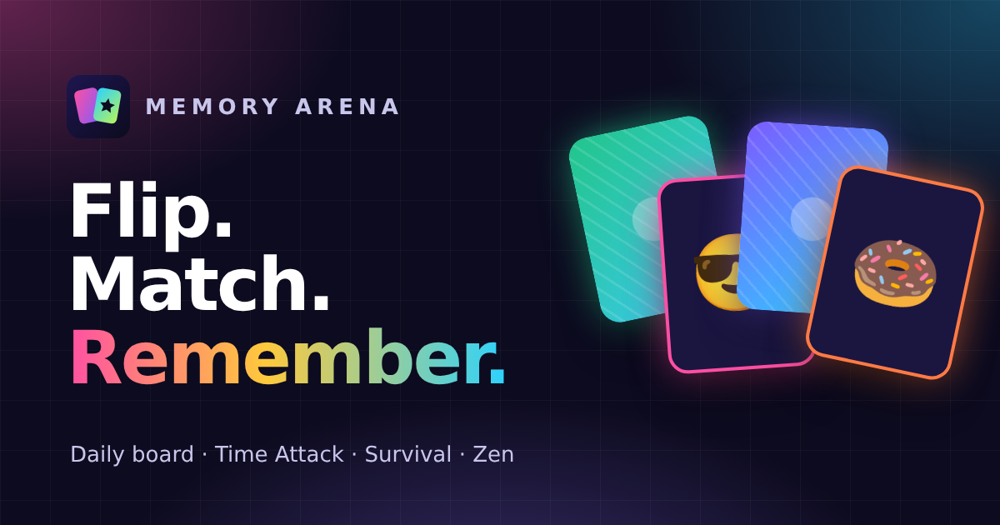

# Memory Arena

A free memory card game with a bit of a stage: five ways to play, a daily board, combos, ranks and
a lot of neon.

Play it at **[memoryarena.netlify.app](https://memoryarena.netlify.app)**



## About

Everyone has played the card game where you turn over two cards and try to find the pairs. Memory
Arena keeps that simple idea and builds an arena around it: modes that change how you think, a board
that's the same for everyone each day, and a rank that grows with every game. It's free, there are no
ads and no account, and your progress stays in your browser.

## Features

- **Five modes**
  - **Classic**: the full game with a score. Pairs in a row build a combo of up to ×5.
  - **Daily Arena**: one 5 × 4 board a day, the same for everyone. One scored run, a daily streak
    and a spoiler-free share.
  - **Time Attack**: a countdown clock that gains four seconds for every pair.
  - **Survival**: see the whole board for a moment, then play with three hearts.
  - **Zen**: no clock, no score and unlimited free peeks.
- **Slips, not just misses.** Turning over a card you've never seen is never a mistake. A *slip* is a
  miss you had the information to avoid, and that's what Survival punishes.
- **Stars based on real maths.** A perfect memory still needs about 1.61 moves per pair (Velleman and
  Warrington, 2013). Stars compare your moves with that.
- **Where your memory slipped.** After each game, a heatmap shows which cards you turned over most.
- **Ranks and achievements.** XP from every game moves you from Rookie to Legend, with 21
  achievements to collect and a profile page with personal bests.
- **Seven decks**: animals, smileys, food, space, sports, nature and a mixed deck. Every board size
  and deck combination is guaranteed to have unique pairs.
- **Peek power-up**, a deal animation, combo pops and sound effects, all optional.
- **Playable without a mouse.** Arrow keys move between cards and Enter or Space flips one. Screen
  readers announce cards and matches.
- **Night and day themes**, and a reduce-motion setting.
- **A page for kids** with a small board, animal cards and no clock.

## Run it locally

You need [Node.js](https://nodejs.org/) 20 or newer.

```bash
git clone https://github.com/shoaibmarif/memory-arena.git
cd memory-arena
npm install
npm run dev
```

Then open <http://localhost:5173>.

### Scripts

| Command | What it does |
| --- | --- |
| `npm run dev` | Start the development server with hot reload |
| `npm run build` | Type-check and build the production site into `dist/` |
| `npm run preview` | Serve the production build locally |
| `npm test` | Run the tests (Vitest) |
| `npm run lint` | Lint with Oxlint |

The production build also writes a separate HTML file for every page (each with its own title,
description, social preview and structured data), plus `sitemap.xml`, `robots.txt`, `404.html` and
Netlify's `_redirects` and `_headers`.

## Project structure

```text
src/
  game/              The rules: engine (pure state machine), progress and ranks, daily board, sharing
  hooks/useArena.ts  Adds timers, sounds and saving on top of the engine
  components/game/   Board, cards, HUD, result panel and the game screen
  components/        Layout, dialogs and small UI pieces
  context/           Settings, profile and notifications shared across the app
  data/              Card decks, FAQ and deck landing pages
  pages/             One component per page
  seo/               Site config, per-page SEO metadata and structured data
  __tests__/         Engine, progress, hosting and render tests for every page
scripts/seoPlugin.ts Build step for per-page HTML, the sitemap and Netlify routing
```

Good places to start:

- **Rules and scoring:** `src/game/engine.ts`
- **Ranks, XP and achievements:** `src/game/progress.ts`
- **Card decks:** `src/data/decks.ts`
- **Colours and fonts:** the tokens at the top of `src/index.css`
- **Name, domain and links:** `src/seo/site.ts`

## Tech stack

React 19, TypeScript, Vite, Tailwind CSS 4, React Router and Vitest. Hosted on Netlify.

## Deploying

Connect the repository to Netlify with the build command `npm run build` and the publish directory
`dist`. Routing and caching rules are generated into `dist/` by the build. If you use a different
domain, update `url` in `src/seo/site.ts`.

## Contributing

Bug reports and ideas for new decks or modes are welcome. Please
[open an issue](https://github.com/shoaibmarif/memory-arena/issues) first for anything big, and run
`npm test` and `npm run build` before sending a pull request.

## Author

Made by **Shoaib Arif**

- Portfolio: [shoaibarif.vercel.app](https://shoaibarif.vercel.app/)
- LinkedIn: [linkedin.com/in/shoaibmarif](https://www.linkedin.com/in/shoaibmarif/)
- GitHub: [@shoaibmarif](https://github.com/shoaibmarif)
- Email: [shoaibmuhammadarif@gmail.com](mailto:shoaibmuhammadarif@gmail.com)
